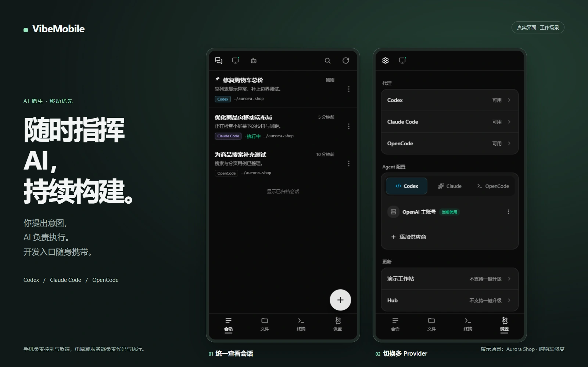
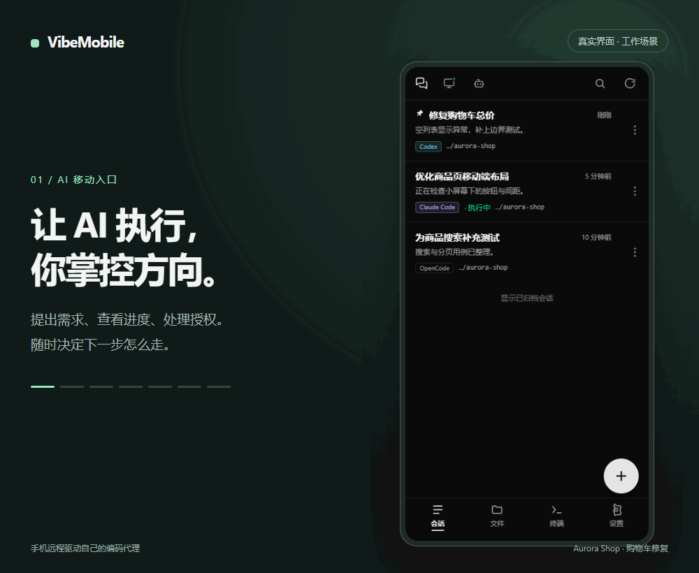
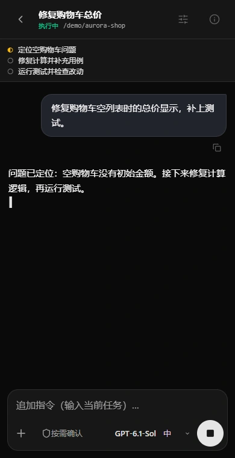
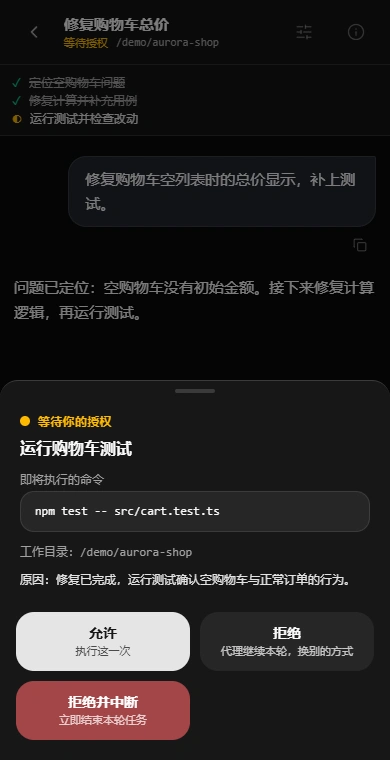
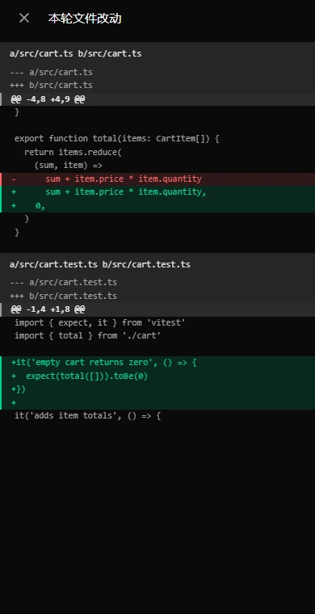
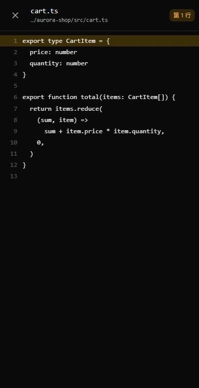
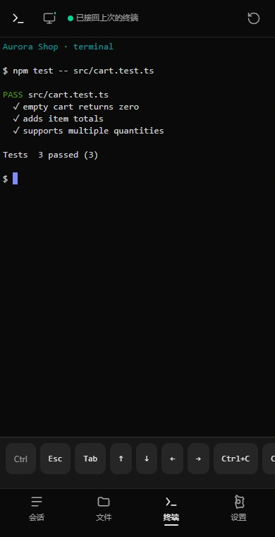
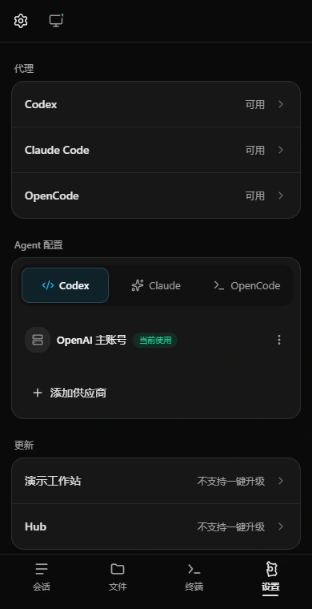
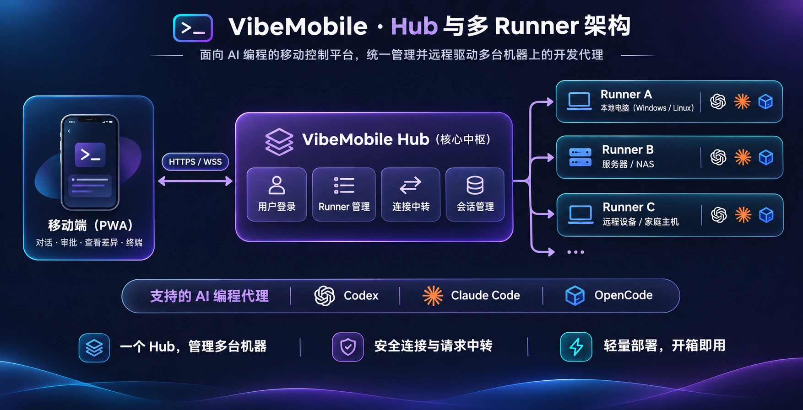

<p align="center">
  
</p>

# VibeMobile

<p align="center">
  <strong>Code Anywhere. Build Anytime.</strong><br />
  让 AI 在电脑上编程，让你随时随地掌控开发。
</p>

<p align="center">
  
</p>

## 重新定义 AI 时代的开发方式

过去，开发者需要持续坐在电脑前完成编码。现在，AI Coding Agent 可以分析项目、修改代码、运行测试并修复问题；开发者则负责提出意图、指导执行、审查结果和做出关键决策。

VibeMobile 让这种协作不再绑定同一台设备或连续在线的时间：手机负责发起任务、查看进度、审批操作和验收结果，电脑或服务器负责代码、工具与执行环境。

| AI 时代的开发职责 | VibeMobile 的移动入口 |
|---|---|
| 提出需求与做出决策 | 在手机上发起任务、补充上下文、处理关键选择 |
| 跟进 AI 执行 | 查看流式输出、计划、工具调用与阻塞状态 |
| 审查与交付结果 | 处理授权、查看 Diff、打开源码、接续终端 |
| 管理多个工作空间 | 通过 Hub 汇总多台机器，随时切换 runner 与项目 |



<details>
<summary>展开查看逐屏截图（7 张）</summary>

<table>
<tr>
<td><br />会话总览</td>
<td><br />实时跟进</td>
</tr>
<tr>
<td><br />授权确认</td>
<td><br />代码 Diff</td>
</tr>
<tr>
<td><br />源码查看</td>
<td><br />终端接续</td>
</tr>
<tr>
<td><br />Provider 设置</td>
<td></td>
</tr>
</table>

</details>

- **演示说明：**真实前端流程，覆盖会话、流式输出、授权、Diff、源码、终端和多 Provider 设置。
- [逐屏截图与复现 / 调整方法](docs/demo.md) · [素材预览](docs/media/index.html)（本地浏览器打开；GitHub 显示 HTML 源码）。

VibeMobile 是一个开源的、面向移动端的 AI Coding Agent 控制平台。它不把传统 IDE 塞进手机，而是让手机浏览器成为随身的 AI 开发控制台：你可以发起开发任务、与 AI 对话、查看执行过程、审批操作、审查代码变更，必要时直接操作终端。真正的代码和执行环境仍运行在你的电脑或服务器上；Hub + multi-runner 还能把多台机器汇总到一个入口，随时切换工作空间。

**Your machine does the work. Your AI writes the code. You stay in control.**

完整产品理念见 [docs/vision.md](docs/vision.md)。

> **安全提示：VibeMobile 是单用户工具。** 登录后即可在宿主机上执行任意命令；
> 「完全访问」档等同于无人值守。**不要直接暴露到公网** —— 需要公网访问时，请
> 在前面使用 HTTPS 反向代理或安全隧道，并先阅读 [SECURITY.md](SECURITY.md)。

## 功能

- **三个代理后端**：Codex（app-server JSON-RPC）、Claude Code（Agent SDK）和
  OpenCode（HTTP + SSE；优先接入用户自己的后台 service），前端只消费归一化事件。
- **流式输出**：逐 token 增量、推理过程、工具调用、计划（todo）和用量。
- **审批**：命令 / 文件修改 / 权限请求以弹窗呈现；Claude 的
  `AskUserQuestion` 渲染成完整表单。
- **会话**：搜索、置顶、归档、重命名、删除、fork；刷新页面不影响后端执行。
- **文件**：查看代理引用到的文件、源码行号 / Markdown 预览、Diff、编辑保存
  （带乐观并发保护）。
- **终端**：直连 PTY，断开重连后仍是同一个 shell 和同一块屏幕。
- **图片**：手机相册 / 拍照输入，内容寻址落盘，转写里只传 token。
- **多机器**：推荐使用 Hub + 多个 runner，统一管理不同机器上的工作空间并随时切换；runner 主动连接、无需开放入站端口。
- **PWA**：可添加到主屏幕，独立窗口运行。

## 部署

> **推荐部署：Hub + multi-runner。** 用一个 Hub 汇总管理多台开发机器和多个工作空间，手机可以随时切换；runner 主动连接 Hub，无需为每台机器开放入站端口。单机部署适合快速体验，多机器场景请参考 [multi-runner 部署说明](docs/multi-runner.md)。

<p align="center">
  
</p>

要求 **Node.js 20+**（推荐 22），npm，以及至少一个已登录的代理 CLI。

### 生产

```bash
npm ci
npm run build:all      # 注意：只跑 npm run build 只会构建前端
npm start              # 默认 0.0.0.0:3000
```

首次启动会自动生成 16 位强密码（大小写字母、数字与符号）作为 PIN 并打印在日志里。想固定 PIN 就设置
`VIBEMOBILE_PIN`。手机连同一个网络，打开日志里的局域网地址即可。

### Docker

```bash
cp .env.example .env
docker compose up -d --build
docker compose logs -f
```

### Windows 服务 / PM2 / 多机器

完整步骤和验证判据见 [docs/deployment.md](docs/deployment.md)：

- Windows：`scripts\windows\install-service.bat`
- Linux/macOS：`npm run release` + `deploy/install.mjs`
- 多机器：[docs/multi-runner.md](docs/multi-runner.md)

## 开发

### 本地开发

```bash
npm ci
npm run dev            # 后端 5800 · 前端 5802 · app-server 6800
npm run dev:server     # 只起后端
npm run dev:web        # 只起前端
```

端口被占用时整段换掉：

```bash
node scripts/dev.mjs --server-port=5900 --codex-port=6901 --web-port=5902
```

开发模式后端直接跑源码（tsx），前端由 Vite 热更新，不需要先构建。

## 验证

```bash
npm run lint           # Biome
npm run typecheck      # 前后端 tsc（server 的 scripts/ 也包含在内）
npm test               # vitest：server + web
npm run test:coverage  # 覆盖率报告
npm run build:all      # 两端生产构建
```

单元测试覆盖映射、权限、分页、转写读取、图片、文件读写等纯逻辑；浏览器交互和
真实协议另有集成脚本：

```bash
# 不需要先起服务（脚本自己 spawn CLI）
npm run test:approval
npm run smoke
npx tsx apps/server/scripts/smoke-image.ts
npx tsx apps/server/scripts/smoke-claude.ts
npx tsx apps/server/scripts/test-claude.ts

# 需要服务在跑（<PIN> 是登录 PIN）
npm run test:hub -- <PIN>
npm run test:terminal -- <PIN>
npm run smoke:browser -- <PIN>
node apps/web/scripts/smoke-claude-browser.mjs <PIN>
```

脚本各自钉住的东西和前置条件见 [CONTRIBUTING.md](CONTRIBUTING.md)。

## English

VibeMobile is an AI-native, mobile-first control plane for coding agents. It
separates the developer's mobile control surface from the code and execution
environment running on a computer or server. It supports **Codex**, **Claude
Code**, and **OpenCode** with streaming output, approval sheets, file diffs, a
persistent terminal, and image input.

The Node backend is not optional: `codex app-server` rejects WebSocket upgrades
that carry an `Origin` header, and browsers always send one, so the backend acts
as the WS client.

Quick start:

```bash
npm ci
npm run dev            # backend 5800 · web 5802 · app-server 6800
```

Production:

```bash
npm ci
npm run build:all      # builds web AND server
npm start              # 0.0.0.0:3000
```

**Security:** this is a single-user tool that can run arbitrary commands. Never
expose it directly to the internet. See [SECURITY.md](SECURITY.md) and the
[deployment guide](docs/deployment.md). Contributions are welcome — see
[CONTRIBUTING.md](CONTRIBUTING.md). Licensed under MIT.

## 架构

```text
手机浏览器 ──HTTP/WS(局域网)──► Node 后端 ──WS(127.0.0.1)──► codex app-server
   React PWA      PIN → JWT       Fastify      JSON-RPC 客户端    （由后端 spawn 托管）
                                    ├── Claude Agent SDK（每回合一个子进程）
                                    ├── opencode HTTP + SSE（attach 或私有 serve）
                                    └── node-pty（终端直连）
```

**为什么必须由后端代理**：`codex app-server` 会拒绝任何带 `Origin` 头的 WS
升级请求，而浏览器发起的 WS 一定带 `Origin`。所以浏览器无法直连 app-server，
必须由 Node 后端充当 WS 客户端。这是约束，不是取舍。

**Provider 接缝**：`apps/server/src/providers/types.ts` 的 `AgentProvider` 是唯一
抽象；`routes/` 与 `ws/hub.ts` 完全 provider-agnostic。增加一个 provider =
实现接口 + 在 `apps/server/src/index.ts` 里 `registry.register()`。

三个后端的会话模型不同（常驻进程 / 每回合一个子进程 / HTTP 服务；续接方式；
插话方式；元数据存储），详见 [docs/architecture.md](docs/architecture.md)。影响正确性的
接缝和“改错不会报错、只会静默出错”的约束集中在 [CLAUDE.md](CLAUDE.md)。

## 权限档位

输入框上的权限项**每回合**决定沙箱和审批策略，并覆盖建会话时的预设。四档：

| 档位 | Claude | Codex | OpenCode | 说明 |
|---|---|---|---|---|
| 按需确认 | `default` | `workspace-write` + `on-request` | `*/* → ask` | 需要时弹审批 |
| 只读 | `plan` | `read-only` | — | 只读探索 |
| 自动判断 | `auto` | — | — | Claude 专属；**不弹审批**，判不了时直接拦掉动作 |
| 完全访问 | `bypassPermissions` | `danger-full-access` | `*/* → allow` | **无人值守**，不再有任何确认 |

- OpenCode 没有 OS 沙箱（`plan` 仍允许 shell），所以只提供「按需确认 / 完全访问」两张卡。
- 读不到会话当前档位时一律兜底到「按需确认」，绝不填「上次选过的那档」。
- 「自动判断」不向手机抛审批，屏幕上看不出它放过了什么；它也不能在建会话时选。
- 「完全访问」是本应用里唯一能让一部手机拿到无限制机器权限的入口。

详细约束和已知边界见 [docs/limitations.md](docs/limitations.md)。

## 项目结构

```text
apps/server/src/
  codex/          AppServerClient · supervisor · mapEvents · permission
  claude/         ClaudeProvider · transcript · mapClaudeEvents / mapUtils
                  · runtime · turnInput · permission
  opencode/       OpencodeProvider · client(HTTP+SSE) · server(attach/spawn)
                  · transcript · mapEvents · permission
  providers/      AgentProvider 抽象 · registry · sessionPrefs · 分页
  images/         用户图片的内容寻址存储
  ws/             hub（事件扇出）· terminal（PTY 桥）
  routes/         REST：auth / sessions / files / images / health
  distributed/    Hub / runner / bridge / tunnel
apps/web/src/
  pages/          Sessions · Chat · Files · Terminal · Settings · Login
  components/     Composer · ApprovalSheet · FileBody / FileViewer / FileEditor
  lib/            store（流式缓冲）· ws（重连）· api · fileLink · permission
packages/protocol/src/
  events.ts       归一化 AgentEvent 契约（手写）
  api.ts          REST DTO（手写）
  generated/      Codex app-server 生成类型（gitignore，仅作协议参考）
```

## 文档

| 文档 | 内容 |
|---|---|
| [docs/vision.md](docs/vision.md) | AI 原生、移动优先的开发协作理念与产品定位 |
| [docs/architecture.md](docs/architecture.md) | 架构、数据流、provider 接缝、分页、图片、终端 |
| [docs/deployment.md](docs/deployment.md) | 四种部署方式、环境变量、健康检查 |
| [docs/limitations.md](docs/limitations.md) | 已知限制和行为边界 |
| [docs/multi-runner.md](docs/multi-runner.md) | Hub / runner 多机器模式 |
| [docs/hub-tls.md](docs/hub-tls.md) | 原生 TLS、私有 CA、Nginx |
| [docs/releasing.md](docs/releasing.md) | 版本号、打包、Codex CLI 升级流程 |
| [docs/error-reporting.md](docs/error-reporting.md) | 代理失败、重试与错误卡片 |
| [CONTRIBUTING.md](CONTRIBUTING.md) | 开发、测试、PR 约定 |
| [SECURITY.md](SECURITY.md) | 威胁模型、漏洞报告、安全部署清单 |
| [CHANGELOG.md](CHANGELOG.md) | 变更记录 |
| [CLAUDE.md](CLAUDE.md) | 面向编码代理的实现约束和操作手册 |

## 已知限制（摘要）

- 新建会话时选的沙箱会被输入框上的权限项覆盖；9 种组合里有 6 种在输入框上
  表达不出来。
- Claude 检测不到桌面端 CLI 的并发写入。
- 「完全访问」等同于无人值守；「自动判断」不弹审批。
- 图片缓存不跟随会话删除，也没有容量上限（整个删掉永远安全）。
- Codex 的 `request_user_input` 链路只验证了一半。
- 新建但未发消息的 Codex 会话，服务重启后找不回来。
- OpenCode 没有 OS 沙箱，只有「按需确认 / 完全访问」；HTTP API 是 experimental，
  版本与行为按 manifest 精确 pin。
- OpenCode 断线后没有事件回放；进行中的回合靠消息重读恢复，可能缺少极短的增量。
- UI 目前只有中文；未在真机 iOS Safari / Android Chrome 上完整验证。

完整说明见 [docs/limitations.md](docs/limitations.md)。

## 贡献

欢迎 issue 和 PR。开始之前请读 [CONTRIBUTING.md](CONTRIBUTING.md)。安全问题
请按 [SECURITY.md](SECURITY.md) 私下报告，不要公开披露未修复的漏洞。

## License

[MIT](LICENSE)
