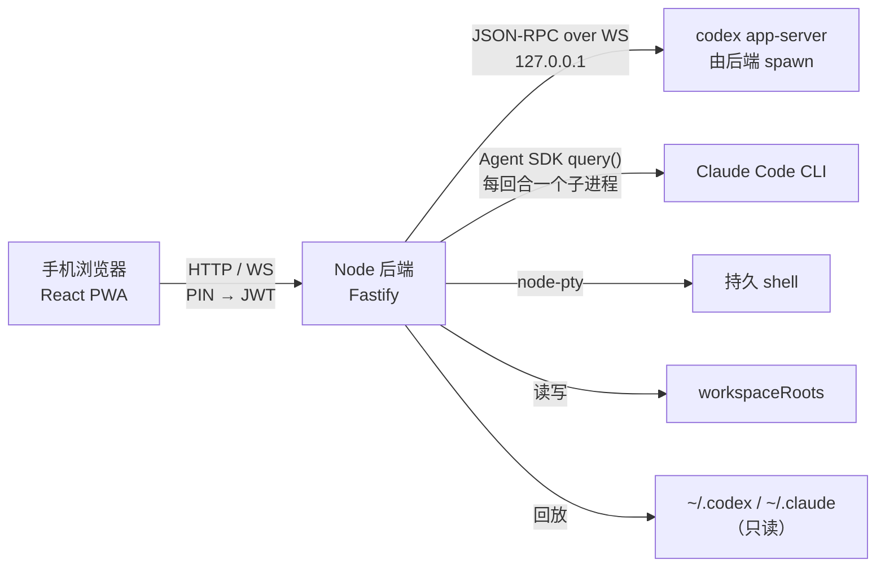

# 架构

本文给第一次阅读代码的人一个整体地图。**影响正确性的细节约束**（哪些地方改错
不会报错、只会静默出错）集中在 [CLAUDE.md](../CLAUDE.md)；这里只讲结构和数据流。

## 总览



## 为什么必须由后端代理

`codex app-server` 会拒绝任何带 `Origin` 头的 WebSocket 升级请求，而浏览器发起
的 WS 一定带 `Origin`。因此浏览器**不能**直连 app-server，必须由 Node 后端充当
WS 客户端。这是约束，不是取舍。

选择 `codex app-server` 而不是 `@openai/codex-sdk`，是因为后者包装的是
`codex exec --json`，会丢弃 delta 通知，拿不到逐字流式。

## Provider 接缝

`apps/server/src/providers/types.ts` 的 `AgentProvider` 是唯一的抽象：

```text
routes/  ws/  ──►  AgentProvider  ──►  CodexProvider
                   （归一化事件）  └──►  ClaudeProvider
```

- `routes/` 和 `ws/hub.ts` 完全 provider-agnostic。
- 前端只消费 `packages/protocol/src/events.ts` 里的归一化 `AgentEvent`，不感知
  任何一个代理的私有协议。
- 增加一个 provider = 实现 `AgentProvider` + 在 `apps/server/src/index.ts` 里
  `registry.register()`。

两个后端的会话模型不同：

| | Codex | Claude Code |
|---|---|---|
| 传输 | 常驻 app-server，JSON-RPC over WS | SDK `query()` |
| 进程 | 一个长驻进程，服务全程复用 | 每回合一个子进程，回合结束即退出 |
| 续接 | 订阅同一个 thread | 首回合传 `sessionId`，之后传 `resume` |
| 回合中插话 | 原生 `turn/steer` | 保持 stdin 打开，消息折进当前回合 |
| 会话元数据 | app-server 的 thread 记录 | 没有对应物，由本服务存档 |
| 端口 | 占一个 | 不占 |

Claude 的 session id 由本服务用 `randomUUID()` 生成，第一回合通过
`options.sessionId` 交给 CLI —— 这是「每回合一个子进程」仍能有稳定路由 id 的原因。

Claude 侧的文件分工：

| 文件 | 职责 |
|---|---|
| `claude/ClaudeProvider.ts` | provider 生命周期、回合、审批、live 状态 |
| `claude/transcript.ts` | JSONL 读取、压缩分段排序、`buildTurns` 回放 |
| `claude/mapClaudeEvents.ts` | 实时 SDK 帧 → `AgentEvent` 的状态机 |
| `claude/mapUtils.ts` | 工具调用 / 结果 / 用量的纯映射函数 |
| `claude/turnInput.ts` | 保持打开的 streaming input |
| `claude/runtime.ts` | 探针、模型标签、超时、config 目录等无状态辅助 |
| `claude/permission.ts` | 权限卡 ↔ `permissionMode` 的纯映射 |

## 会话路由

会话 id 是裸的，多数请求不带 provider。`providers/registry.ts` 维护
`sessionId → providerId` 反查表：

- 每个学到 id 的路径都会 `bind()`。
- `forSession()` 未命中时依次询问 provider，最后兜底 `registry.default`。
- `registry.default` 是第一个注册的 provider（Codex），注册顺序是有意的。
- `GET /api/sessions` 不带 `provider` 时只返回 Codex 会话；`?provider=all`
  才会聚合全部。未知 provider 值兜底成 `default`。
- 审批不走会话 id：`ws/hub.ts` 另建 `requestId → providerId` 表来转发。
  `approval.requested` / `approval.resolved` 是全局广播，两半必须成对发送。

## 前端

- `apps/web/src/lib/store.ts` 把流式 delta 攒在模块级可变结构里，每帧（rAF）
  最多 flush 一次；后台标签页回退到 50ms 定时器。
- `item.completed` 是权威事件，会丢弃对应 buffer。
- `lib/ws.ts` 负责自动重连和订阅重放。`Query` 活在 Node 进程里，刷新页面不会
  影响后端执行；恢复靠 `resumeSession` 重放 live 状态 + `getTranscript` 追加
  进行中的回合。
- 会话列表和文件页都记住离开时的位置。状态放模块作用域，不放组件 state，
  因为切换底部导航会卸载页面。
- 上翻分页的锚点是「距底距离」，在响应落地那一刻测量；`loadingOlder` 不能复用
  页面级 `loading`。
- 页面逻辑留在 `pages/`；`Chat` 的头部、消息列表、流式块、错误页、浮层拆在
  `components/Chat*.tsx` / `StreamingBlock.tsx`，会话行和列表拆在
  `SessionRow.tsx` / `SessionList.tsx` / `SessionListEmpty.tsx`。这些组件只拿
  props，不持有分页和滚动状态。
- 非首页路由用 `React.lazy` 按需加载；`vite.config.ts` 再把 React / Radix /
  Markdown / xterm 拆成 vendor chunk。终端（xterm）和聊天/文件预览
  （react-markdown）不会进入首屏包。

## 转写与分页

- `packages/protocol/src/events.ts` 的 `AgentEvent` 是前后端唯一契约。
- `?items=` 表示「大约多少个渲染条目」，`?limit=` 表示轮数；两者共用一个游标。
- 分页切在整轮边界；只要还有更旧的轮就绝不返回空页。
- Codex 的游标来自 app-server；Claude 的游标是自铸的 `c:<跳过的轮数>`。
- Claude 的转写读取会跨压缩边界分段，每段独立排序，边界作为可见的
  `compaction` item 插入。

## 图片

用户发出的图片落盘在 `.vibemobile/images/`，内容寻址（`<sha256[:32]>.<ext>`）。
转写里只放 `/api/images/<token>`。

- 代理的会话文件**只读**：绝不写 `~/.codex/sessions/**` 或
  `~/.claude/projects/**`。
- `ImageStore` 没有内存态，文件系统就是全部状态；`stateDir` 缺席时视为没有
  store，原始 data URL 不会进入 item。
- 落盘走 `normalizeItem(item, { onImage })` 回调，而不是「先放进 item 再改写」。
- `GET /api/images/:id` 是仓库里唯一的非 JSON 路由；未命中必须带
  `Cache-Control: no-store`。

## 终端

- shell 属于终端，不属于 socket。socket 关闭只是 detach，PTY 继续运行。
- 重连时先发屏幕快照，再补发快照期间到达的输出。
- 身份是 `sessionStorage` 里的 id：刷新保留，新标签页另起。
- 回收条件是「没有任何连接 + 超过 `VIBEMOBILE_TERMINAL_IDLE_MS`」。

## 文件引用、查看与编辑

- 代理写出的 Markdown 链接是文件路径，不是页面地址。
  `apps/web/src/lib/fileLink.ts` 的 `parseFileRef()` 把它们解析成本机路径。
- 文件内容走 `/api/files/content`，仍受 `workspaceRoots` 约束。
- 查看器只有一份实现：`components/FileBody.tsx`；浮层
  `components/FileViewer.tsx` 只负责抓取和头部。
- 写入只有一条路：`files/workspace.ts` 的 `writeFileText()`，只能改、不能新建。
- 保存使用 `rev` 做乐观并发保护；不匹配返回 `409 file_changed`，前端保留草稿。

## 配置与状态

`apps/server/src/config.ts` 的 `repoRoot()` 从模块位置向上找带 `workspaces` 的
`package.json`，不是从 cwd 解析。配置里的路径都是仓库相对。

默认状态目录是 `.vibemobile/`，包含：

- `state.json`：JWT 签名密钥和 PIN
- `codex-sessions.json` / `claude-sessions.json`：会话元数据存档
- `images/`：图片缓存（纯缓存，可整个删除）

**这些文件都已被 gitignore，不能提交。**

## 构建戳

前后端是两半，构建方式和生效方式不同：

- 前端 `dist` 由 `@fastify/static` 按请求读磁盘，重建后刷新浏览器即可生效。
- 后端 `dist` 在进程启动时载入，重建后必须重启服务。

`/api/health` 同时返回进程启动时读到的 `build` 和磁盘上的 `buildOnDisk`，设置页
据此提示“已重建但未重启”。构建信息由 `scripts/build-info.mjs` 统一生成。
