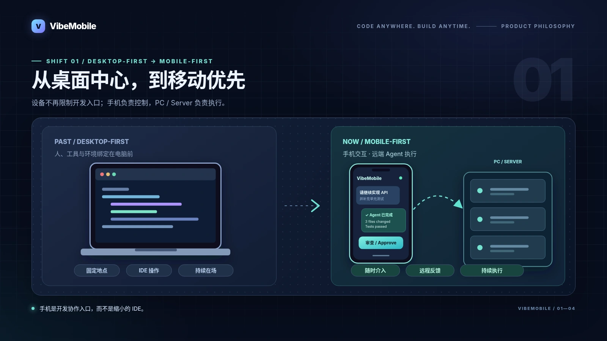
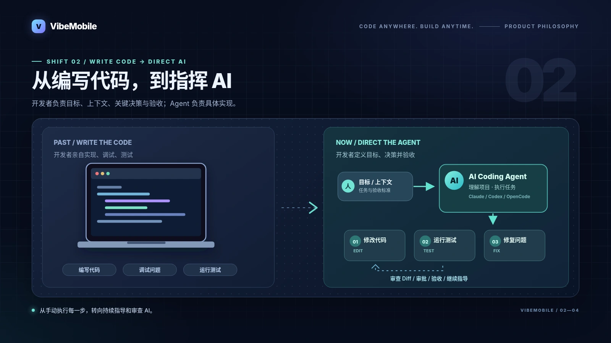
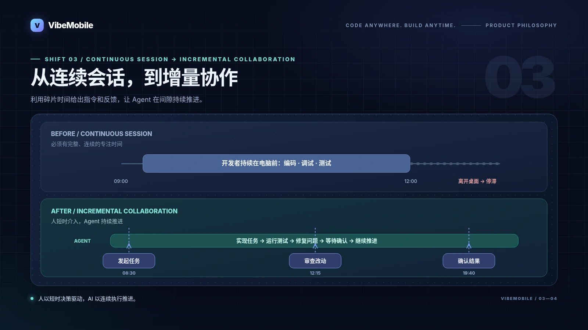
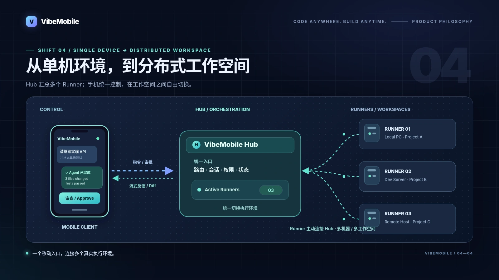

# 产品理念

## Code Anywhere. Build Anytime.

VibeMobile 面向 AI Coding Agent 时代，提供一个 AI 原生、移动优先的开发协作入口。让 AI 在电脑或服务器上编程，让开发者通过手机随时提出需求、指导执行、审查结果并做出决策。

## 从桌面中心到 AI 原生、移动优先

过去，开发主要围绕电脑、IDE 和连续的专注时间展开。AI Coding Agent 出现后，开发者的核心工作逐渐转向表达意图、拆解任务、处理阻塞、审查改动和验收结果。

VibeMobile 将人机交互与代码执行解耦：手机负责控制和反馈，电脑或服务器负责代码、工具与运行环境。开发不会因为人暂时离开桌面而中断，协作也不再要求人和执行环境处在同一个地点。

## 四个变化

### 1. 从 Desktop-First Development 到 Mobile-First Development

电脑仍然是代码和工具的执行环境，但不再是参与开发的唯一入口。开发者可以在通勤、会议间隙或家中查看进度、补充要求和处理授权。

  

### 2. 从编写代码到指挥 AI

开发者负责目标、上下文、关键决策与验收；AI Coding Agent 负责理解项目、修改代码、运行测试和修复问题。VibeMobile 提供完整的反馈链路，让每一步都可跟进、可审查、可干预。

  

### 3. 从连续会话到增量协作

传统编程通常需要一段连续的专注时间。AI 协作允许开发者在多个短时间窗口中发起任务、查看进展、处理阻塞，再让 Agent 继续推进。

  

### 4. 从单一设备到分布式工作空间

计算环境与人机交互可以分布在不同设备上：电脑或服务器负责执行任务，手机负责控制和反馈。Hub + multi-runner 模型把多台开发机器和多个工作空间汇总到一个入口，runner 主动连接 Hub，开发者可以从手机随时切换执行环境。

  

## 产品定位

VibeMobile 不是把传统 IDE 缩小到手机上，也不是只提供一个 SSH 或远程桌面入口。它围绕 AI Coding Agent 的协作环节设计移动体验：

| 传统移动编程 | VibeMobile：AI 原生移动开发 |
|---|---|
| 手机操作 IDE、人工编写代码 | 手机提出需求、审批操作、验收结果 |
| 人负责大部分实现与调试 | Claude Code、Codex、OpenCode 负责具体执行 |
| 设备同时承担交互和运行环境 | 手机负责控制，PC / Server 负责代码、工具与执行环境 |
| 每台机器分别登录和管理 | Hub 汇总多个 runner，手机随时切换工作空间 |

## 当前能力与边界

当前版本聚焦 AI Coding Agent 的移动控制，支持 Codex、Claude Code 和 OpenCode，并提供流式对话、权限审批、文件 Diff、源码查看与编辑、持久终端、图片输入、Provider 切换和 Hub + multi-runner 多机器连接。推荐部署方式是用 Hub 统一管理多个 runner，再从手机随时切换工作空间。

文档中的愿景用于说明产品方向；具体已实现能力以 README 的功能列表和实际版本为准。未来可以沿着统一 Provider、会话、审批与工作空间的基础，扩展到更多 Agent 场景，但当前产品定位仍聚焦编码协作。

> 我们不是在做一个可以写代码的手机 IDE，而是在为 AI Agent 时代设计新的移动工作入口。
